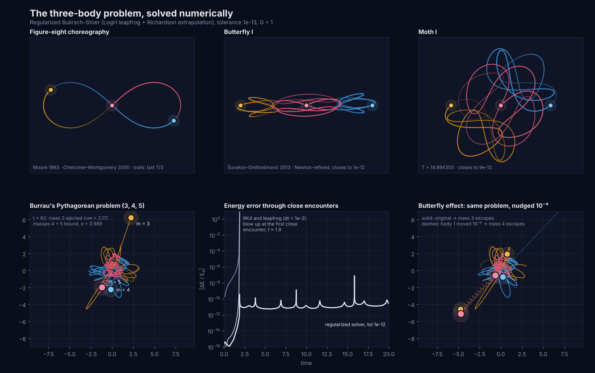

# The three-body problem

The general equation for three (or N) gravitating bodies, a solver that integrates it to about twelve significant digits, and an interactive page that shows it working. This folder is self-contained and unrelated to the rest of the repository.



Animation: [`figures/pythagorean.mp4`](figures/pythagorean.mp4), Burrau's problem from rest to ejection.

## The equation

For bodies $i = 1, 2, 3$ with masses $m_i$ and positions $\mathbf r_i$:

$$
\ddot{\mathbf r}_i = -G\sum_{j\neq i} m_j\,\frac{\mathbf r_i-\mathbf r_j}{\left(\lvert\mathbf r_i-\mathbf r_j\rvert^{2}+\varepsilon^{2}\right)^{3/2}}
$$

with $\varepsilon = 0$ for point masses ($\varepsilon > 0$ softens close encounters). It covers stars, planets and moons alike. Only the masses and the initial positions and velocities change. Written out, it is 18 coupled first-order ODEs. The equivalent Hamiltonian is

$$
H=\sum_{i}\frac{\lvert\mathbf p_i\rvert^{2}}{2m_i}-\sum_{i<j}\frac{G m_i m_j}{\lvert\mathbf r_i-\mathbf r_j\rvert}.
$$

**Any scale.** With a length unit $L$, a mass unit $M$ and the time unit $t_* = \sqrt{L^3/(GM)}$, the equation becomes dimensionless with $G = 1$. One solution therefore describes every system with the same mass ratios and shape. For $L$ = 1 AU and $M$ = 1 M☉, $t_*$ = 58.13 days.

**Triangle form** (Lagrange). With the sides $\mathbf s_1=\mathbf r_3-\mathbf r_2$, $\mathbf s_2=\mathbf r_1-\mathbf r_3$, $\mathbf s_3=\mathbf r_2-\mathbf r_1$ (which sum to zero):

$$
\ddot{\mathbf s}_i=-GM\frac{\mathbf s_i}{s_i^3}+G m_i \mathbf S,\qquad \mathbf S=\sum_j \frac{\mathbf s_j}{s_j^3}.
$$

## What "solving" it means

The motion conserves ten quantities: energy, momentum (3), angular momentum (3) and the centre-of-mass drift (3). Bruns (1887) and Poincaré (1890) proved there are no others, so **no general closed-form solution exists**. What does exist:

1. **Sundman's series** (1912) converge for all time when $\mathbf L \neq 0$, but need on the order of $10^{8{,}000{,}000}$ terms in practice.
2. **Exact special solutions.** Lagrange's equilateral triangle and Euler's collinear line work for any masses (`presets.lagrange`, `presets.euler`). The figure-eight and the Šuvakov–Dmitrašinović orbits are periodic.
3. **Numerical integration with controlled error.** This is what `Solver` does. The limit is chaos: errors grow like $e^{\lambda t}$, so predictions from double-precision starting data last about $\ln(10^{16})/\lambda$ time units.

## The solver

`threebody.Solver` (Python) and `web/solver.js` (browser/Node) implement the same algorithm. It is Bulirsch–Stoer extrapolation of the logarithmic-Hamiltonian leapfrog (Mikkola & Tanikawa 1999; Preto & Tremaine 1999):

$$
\frac{dt}{ds}=\frac{1}{T+B},\qquad \frac{d\mathbf v_i}{ds}=\frac{\mathbf a_i}{U},\qquad B=-E_0 .
$$

The time transformation regularizes binary collisions: the leapfrog reproduces Kepler orbits exactly, even through a collision. Richardson extrapolation over 2, 4, 6, … substeps gives roughly tenth-order accuracy with automatic step control.

```python
from threebody import Solver, presets, analysis

m, x, v = presets.pythagorean()           # Burrau 1913: masses 3, 4, 5 at rest
traj = Solver(m, x, v, tol=1e-12).integrate(70.0, dt_out=0.01)
print(traj.stats["dE_rel"])                # ~1e-11
print(analysis.classify(traj.x[-1], traj.v[-1], m))   # mass 3 escapes, 4+5 bound, e ≈ 0.99
```

## Validation (`tests/test_threebody.py`, 16 tests)

| Check | Result |
|---|---|
| Pythagorean problem outcome (Szebehely & Peters 1967) | mass 3 ejected at t ≈ 60, 4+5 binary with e ≈ 0.988 |
| Energy through a 0.0006 close approach | 7 × 10⁻¹¹ relative error over t = 80 |
| Agreement with SciPy DOP853 (rtol 10⁻¹³), chaotic run to t = 15 | < 10⁻⁵ |
| Figure-eight return after one period | 3 × 10⁻⁸ (limited by 8-digit published ICs) |
| Lagrange triangle, 3 mass sets | stays equilateral to 10⁻⁸ |
| Euler line, 3 mass sets | λ solves Euler's quintic; stays collinear to 10⁻⁷ |
| Head-on collision (true singularity) | passes through, energy error < 10⁻⁸ |
| Fixed-step RK4 / leapfrog on the same problem | both blow up at the first close encounter |
| Newton-refined periodic orbits | close to ~10⁻¹² (published values: ~10⁻³) |

## Periodic orbits refined by Newton shooting

`scripts/refine_periodic.py` treats $(p_1, p_2, T)$ as unknowns and drives $\text{state}(T) - \text{state}(0)$ to zero with Levenberg–Marquardt. The results are in `data/periodic_orbits.json`.

| Orbit | published closure | refined closure | refined T |
|---|---|---|---|
| Figure-eight | 7.2e-06 | 7.3e-14 | 6.3259139829 |
| Butterfly I | 1.2e-03 | 1.2e-12 | 6.2346748388 |
| Butterfly II | 3.2e-04 | 2.6e-12 | 7.0037096006 |
| Butterfly III | 1.8e-03 | 3.9e-12 | 13.8671234358 |
| Moth I | 2.3e-04 | 9.3e-13 | 14.8943051750 |
| Moth II | 5.9e-04 | 2.8e-12 | 28.6692709151 |
| Moth III | 2.2e-03 | 7.0e-12 | 25.8392363564 |
| Goggles | 2.4e-03 | 7.4e-12 | 10.4648495259 |
| Yin-yang Ia | 8.6e-04 | 2.1e-12 | 17.3288340186 |
| Yin-yang Ib | 8.8e-04 | 1.3e-12 | 10.9633030881 |
| Dragonfly | 2.0e-03 | 7.1e-12 | 21.2723373946 |
| Yarn | 7.0e-04 | 1.8e-11 | 55.5024233887 |
| Bumblebee | 5.1e-04 | 3.8e-11 | 63.5343533410 |
| Butterfly IV | 1.3e-03 | 9.9e-10 | 79.4749539062 |

## The interactive page (`web/`)

`web/dist/index.html` is a single self-contained page:

- **Live simulator** with 25 systems: exact solutions for any masses, 13 periodic orbits, Burrau's problem, Kepler-16, a star–planet–moon system, a binary–single exchange, Kozai–Lidov cycles (3D), the Sitnikov problem (3D), a Trojan at L4 and random triples.
- **Gravity field** as potential contours (WebGL) in the plane view, or a rubber-sheet well in 3D. In the co-rotating frame it becomes the effective potential, with L1–L5 marked.
- **Butterfly twin**: a second copy displaced by δ, with its separation measured exactly at the same instants and a fitted Lyapunov exponent.
- **Instruments**: energy and angular-momentum drift, nearest-neighbour distances, Montgomery's shape sphere, outcome classification (escape, hierarchical, interplay) and an exact return check for periodic orbits.
- **Editing**: pause, then drag a body or its velocity arrow, or edit the table of initial conditions. Mass sliders rebuild the Lagrange and Euler solutions for the new masses.
- **Fate map**: 96,000 free-fall integrations (400 × 240), coloured by escape time or by escaper. Clicking a pixel replays that exact integration.

## Running it

```bash
# Python: tests, figures, periodic-orbit refinement
pip install numpy scipy matplotlib pytest
python -m pytest -q tests
python scripts/make_figures.py
python scripts/make_animation.py     # needs ffmpeg
python scripts/refine_periodic.py butterfly_I moth_I

# Web: fate map (~10 min on 4 cores) and page build
cd web
npm install
npm run fatemap
npm run build      # -> web/dist/index.html
```
